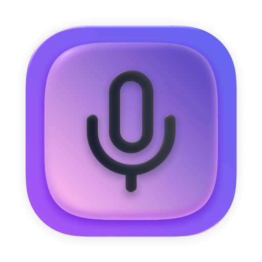
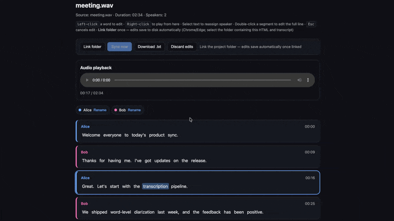

<p align="center">
  
</p>

# MecoScribe

Local **diarized transcription** for macOS, built on [FluidAudio](https://github.com/FluidInference/FluidAudio). MecoScribe is a native Mac app: drop in an audio or video file and get a speaker-labeled transcript you can play back, correct and reassign, all on your Mac. A [command-line tool](#command-line-tool) with the same pipeline is included.

## Features

- **Transcribe from the GUI.** Pick or drop an audio or video file and choose the diarization mode, threshold, ASR model, Nemotron language and chunk size, preset speaker names, and output and model folders. It shows each pipeline stage as it runs, including model downloads (with progress) on first use. If a transcript already exists, you can open it or transcribe again.
- **Projects (`.mscribe`).** The app saves each transcript as one `<audio name>.mscribe` file (see [Project file format](#project-file-format-mscribe)). Opening the CLI's `.txt`, `.mecoscribe.json` or `.html` imports them into a `.mscribe` next to them and leaves the originals untouched. Opening the audio opens its project. The app finds the audio again from the project, or lets you locate it. **Close Project** (⇧⌘W, or the house button) saves and returns to the home screen.
- **Editing**:
  - Click a word to edit it. Typing spaces splits it into several words; clearing it deletes it.
  - Click between words to insert one. Double-click a line to edit the whole line (word timings are kept where words match).
  - **Edit Mode** (⌘1): besides editing, drag across words like selecting text (this also works while a word is open for editing), or Shift/⌘-click them, then choose a speaker from the popover (keys 1–9 pick a speaker) or add a new one. You can also change the speaker of a whole line from its header.
  - **Move Mode** (⌘2): drag words or a selection to a new spot. Their timings move with them.
  - Rename, merge, add, and delete speakers. Delete selected words with ⌫.
  - Undo/redo (⌘Z / ⇧⌘Z), and "Discard All Edits", which can itself be undone.
- **Playback**: word highlighting synced to the audio. ⌥-click a word, or right-click › Play from Here, to play from it. Space plays and pauses. Also skip ±5 s, a scrubber, playback speed, and an optional "follow playback" auto-scroll. When the line being played is scrolled out of view, a **Jump Back** button appears at the top right of the transcript. When the source is a video, the video plays in a pane above the transcript. Drag the bar under it to resize it, and hide it with the video button in the player bar or ⌥⌘V.
- **Updates**: MecoScribe checks [GitHub Releases](https://github.com/HeyMeco/MecoScribe/releases) once a day and offers newer versions (Download, Later, or Skip This Version). Check any time with **MecoScribe › Check for Updates…**, or turn automatic checks off in Settings. Nothing is installed automatically.
- **Saving**: edits save automatically to the `.mscribe` file. If another app changes it, a banner offers *Reload from File* or *Keep My Edits*. You can also export the `.txt`, the HTML viewer, or all three loose files (*Export Separate Files…*, the same layout the CLI writes).

### Models

- **Diarization**: NVIDIA Nemotron 3 by default (Apple Silicon, up to 8 speakers). The offline VBx and streaming pipelines are also available.
- **Speech recognition**: Parakeet Ultra by default, a multilingual model more accurate than Parakeet v3 with the same languages. Parakeet v3, the English-only Parakeet v2, and Nemotron 3.5 multilingual streaming ASR (about 40 languages, Apple Silicon) are also available.

## Requirements

- macOS 14+
- Swift 6.0+ (to build)
- Apple Silicon recommended (uses CoreML / ANE via FluidAudio)
- Network access on first run (models download from Hugging Face)

## Install

```bash
git clone https://github.com/HeyMeco/MecoScribe.git
cd MecoScribe

# Build a double-clickable app bundle into ./dist
./scripts/build-app.sh
open dist/MecoScribe.app

# Or run it directly
swift run MecoScribeApp            # optionally pass a project, transcript or audio path
```

The app stores downloaded models in `~/Library/Application Support/MecoScribe/models`, unless `MECOSCRIBE_MODELS_DIR` is set or another folder is chosen in Settings.

## Project file format (`.mscribe`)

A `.mscribe` file is a ZIP archive, schema version **1.0**:

| Entry | Contents |
| --- | --- |
| `manifest.json` | `format: "mecoscribe"`, `schemaVersion: "1.0"`, `generator`, `createdAt`/`modifiedAt` (ISO 8601), `audio` (`fileName`, `relativePath` from the `.mscribe` folder, `absolutePath`), and `contents` naming the three files below |
| `transcript.txt` | The plain-text transcript, same format as the CLI's `.txt` |
| `transcript.mecoscribe.json` | Word timings, same format as the CLI's sidecar |
| `transcript.html` | The interactive HTML viewer, with audio linked relative to the `.mscribe` folder |

Unzip it next to the audio and the files behave exactly like CLI output. When reading, the app prefers `transcript.txt` (reconciled with the timings), then the timings, then the viewer's embedded data. It rejects files whose major schema version is not 1. Archives re-zipped with Finder (which wraps the files in a folder) also open.

## How it works

1. **Diarization**: FluidAudio identifies who spoke when (NVIDIA Nemotron 3 by default, or the offline VBx or streaming pipelines)
2. **Transcription**: Parakeet Ultra by default, Parakeet v3/v2, or Nemotron 3.5 streaming ASR, with word-level timestamps
3. **Alignment**: words are mapped to speakers by timestamp overlap
4. **Export**: the app saves a `.mscribe` project; the CLI writes the plain-text transcript, timings and the self-contained HTML viewer

## Command-line tool

The `mecoscribe` CLI runs the same pipeline from the terminal and writes the transcript as loose files: a plain-text `.txt`, a `.mecoscribe.json` timings sidecar and a standalone interactive HTML viewer. The Mac app opens these files and converts them into a `.mscribe` project.



### Build

```bash
swift build -c release
```

The CLI binary is at `.build/release/mecoscribe`.

### Usage

```bash
# Basic — Nemotron 3 diarization + Parakeet Ultra (defaults)
swift run mecoscribe meeting.wav

# Specify output directory
swift run mecoscribe interview.mp3 --output-dir ./transcripts

# Previous pipeline: offline VBx diarization + Parakeet v3
swift run mecoscribe call.m4a --mode offline --model-version v3

# Nemotron 3.5 multilingual ASR instead of Parakeet Ultra (Apple Silicon)
swift run mecoscribe call.m4a --model-version nemotron3 --language de-DE

# Preset speaker names
swift run mecoscribe panel.wav --speakers "Alice,Bob,Carol"
```

#### Options

| Flag | Description |
|------|-------------|
| `-o, --output-dir <dir>` | Output directory (default: same folder as audio) |
| `--models-dir <dir>` | Model cache directory (default: `./models`) |
| `--mode streaming\|offline\|nemotron3` | Diarization mode (default: `nemotron3`). `nemotron3` is NVIDIA Nemotron 3 (Apple Silicon, up to 8 speakers); `offline` is the VBx pipeline |
| `--threshold <float>` | Speaker clustering threshold, or Nemotron 3 frame-activity threshold (default: `0.6`) |
| `--model-version v2\|v3\|ultra\|nemotron3` | ASR model — default `ultra` (multilingual Parakeet); `v3` is the previous multilingual Parakeet; `v2` is English-only; `nemotron3` is Nemotron 3.5 streaming multilingual ASR (Apple Silicon) |
| `--language <code>` | Nemotron 3.5 language hint (default: `auto`). Examples: `en-US`, `de-DE`, `fr-FR`, `ja-JP` |
| `--chunk-ms <560\|1120\|2240\|4480>` | Nemotron 3.5 chunk tier (default: `2240`) |
| `--model-dir <path>` | Use local ASR models instead of downloading |
| `--speakers <n1,n2,...>` | Initial speaker display names |
| `-h, --help` | Show help |

### Output

Given `meeting.wav`, MecoScribe produces:

- **`meeting.txt`** — readable transcript:

  ```
  [00:12] Speaker 1:
  Welcome everyone to today's meeting.

  [00:18] Speaker 2:
  Thanks for having me.
  ```

- **`meeting.html`** — open in any browser. The HTML references the original audio file via a relative path, so keep both files together (or open the HTML from the same directory).

The HTML viewer offers:

- Color-coded speaker segments
- Word-level highlighting synced to playback
- Click any word or segment to seek in the audio
- Rename and merge speakers
- Built-in audio player (with playback speed selection)

### Model cache

Downloaded FluidAudio models are stored in `./models` by default (relative to your current working directory). Subsequent runs reuse the cache instead of re-downloading.

Override with `--models-dir /path/to/models` or the `MECOSCRIBE_MODELS_DIR` environment variable.

## License

MecoScribe is licensed under the [MIT License](LICENSE).

FluidAudio models and runtime are subject to their respective licenses (MIT / Apache 2.0). See the [FluidAudio repository](https://github.com/FluidInference/FluidAudio) for details.
